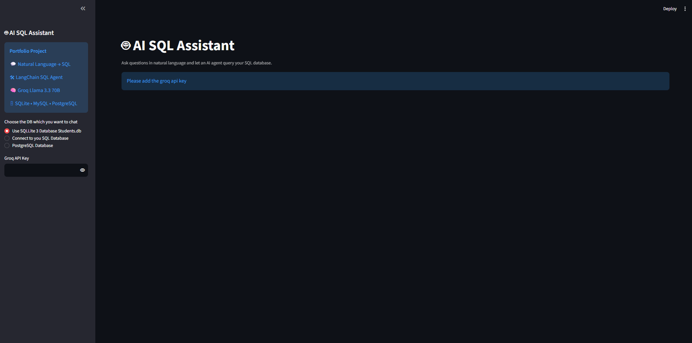

# 🤖 AI SQL Assistant

> A production-inspired Generative AI SQL Assistant that converts natural language into validated, read-only SQL queries using Large Language Models.

## 🎥 Demo

> 🚧 Demo GIF coming soon.

<p align="center">
  
</p>

## Overview
This portfolio project demonstrates practical GenAI engineering by combining LLMs, SQL agents, and database connectivity into an interactive Streamlit application.

### Highlights
- Natural Language → SQL
- Bounded LangChain tool-calling workflow
- Groq-hosted LLM (Qwen 3.6 27B configurable)
- SQLite, MySQL and PostgreSQL support
- Read-only SQL enforcement
- SQL AST validation and database read-only safeguards
- Statement, table and function allowlists at execution
- Buffered LLM responses (displayed after processing)
- Database schema discovery
- Interactive chat interface
- Response time metrics
- Separate connection, validation, execution, generation, chat and presentation modules

## Tech Stack
- Python
- Streamlit
- LangChain
- Groq
- SQLAlchemy
- SQLite
- MySQL
- PostgreSQL (psycopg)
- SQLGlot AST validation

## Features
| Feature | Status |
|---|---|
| Natural language querying | ✅ |
| Multi-database support | ✅ |
| Tool-calling SQL Agent | ✅ |
| Read-only protection | ✅ |
| Schema discovery | ✅ |
| Chat history (session) | ✅ |
| Buffered responses | ✅ |
| Performance metrics | ✅ |
| Database information panel | ✅ |

### Chat Interface


### Database Selection


## Security
- Validates generated SQL before every query execution; natural-language keywords are not a security boundary.
- Prompt instructs the model to generate only SELECT queries.
- SQLite opened in read-only mode.
- Rejects DDL, DML, stacked statements, unapproved tables/functions, comments, locking clauses and SELECT INTO.
- Uses read-only transactions for PostgreSQL/MySQL and execution timeouts. Remote database users must also have SELECT-only privileges.


### SQL Guardrails


## Architecture
```text
Streamlit -> bounded conversation -> Groq tool-calling model
                                      |
                                      v
                              query_database tool
                                      |
                              SQLGlot AST policy
                                      |
                         read-only transaction + timeout
                                      |
                                  SQLAlchemy
```

## Project Structure
```text
app.py                      Streamlit UI and session lifecycle
assistant/connections.py    URLs, connection timeouts, SQLite read-only mode
assistant/validation.py     Generated SQL AST policy
assistant/execution.py      Approved schema and controlled execution
assistant/generation.py     Bounded model/tool loop
assistant/chat.py           Bounded history and database-switch reset
assistant/presentation.py   Single render/store per chat turn
tests/                      Offline regression and application tests
sql_queries.sql             PostgreSQL administrator/loader bootstrap
.github/workflows/tests.yml Offline CI
```

## Installation
```bash
git clone https://github.com/sunshine-engineer/ai-sql-assistant.git
cd ai-sql-assistant
python -m venv .venv
# Activate .venv for your operating system
pip install -r requirements.txt
streamlit run app.py
```

## Why this project?
This application showcases practical GenAI engineering skills including LLM integration, agentic workflows, prompt engineering, SQL safety, multi-database connectivity, bounded context, UI development, and production-oriented guardrails.

## Future Improvements
- Generated SQL viewer
- Result table
- CSV download
- Row count
- Query history
- Authentication
- Docker
- Observability
- Live provider evaluation suite

## License
MIT

## Safety policy and limits

The model has only one query tool, and every execution passes through the same
validator. The initial policy permits simple SELECTs, joins and subqueries;
CTEs, set operations, comments and functions outside the small allowlist are
intentionally rejected. This is a conservative subset, not full SQL support.
Metadata contains column names/types, not sample rows. Only tables discovered
in the selected schema are approved; views and other schemas are excluded.
Python callers can further restrict tables using `QueryService(tables=[...])`.
Use database grants to restrict sensitive tables/columns for deployed use.

Defaults: 200 result rows, 20,000-character serialized tool results (large rows
may be omitted), 5-second query timeout, four query calls and five model rounds.
Only the most recent eight messages, each capped at 2,000 characters, are sent
as conversational context. Switching database connection settings/schema or
clearing history resets the chat. Credentials are not included in model context
or displayed errors. Connections are not globally cached across users.
Responses are buffered, not token-streamed. Earlier screenshots may show the old UI.

### PostgreSQL credentials

`sql_queries.sql` is a **psql bootstrap for a new database**. Run from the
repository root with administrator credentials; `\password` prompts for new
role passwords. It creates separate `genai_loader` and `genai_reader` roles,
loads data with client-side `\copy`, and grants the reader only schema usage,
connection and table SELECT privileges. Use **genai_reader** in the application.
Do not rerun bootstrap against an existing installation. Existing broad roles
are not repaired automatically: provision a fresh restricted reader, audit any
PUBLIC/inherited privileges, then switch the app to that account. Retire the old
assistant credentials separately. Never grant server-file roles to the reader.

### MySQL credentials

For MySQL 8, provision a dedicated role/user with SELECT on approved tables only;
never use root, the loader or an account with FILE/EXECUTE/write privileges.
The application also requests read-only transactions and sets
`MAX_EXECUTION_TIME`. It fixes session SQL mode to strict transactions, full
GROUP BY checks and standard backslash escapes so server parsing matches the
validator; PostgreSQL similarly enables standard-conforming strings. This path targets MySQL, not MariaDB. Administrative SQL
runs outside the model execution path. Review permissions on views, functions,
and PUBLIC/inherited roles before deployment: an AST validator is defense in
depth, not a replacement for database access control.

## Testing

```bash
python -m pip install -r requirements-dev.txt
python -m pip check
python -m pytest -q
```

The default tests are offline: real temporary SQLite databases, SQL policy
regressions, fake-model tool calls, bounded history, connection construction,
and Streamlit application smoke/regression checks. They require no API key.
GitHub Actions runs the offline suite on Python 3.12 and a separate integration
job against disposable PostgreSQL 16 and MySQL 8 services. The two live-server
tests skip locally unless `TEST_POSTGRES_ADMIN_URL` and
`TEST_MYSQL_ADMIN_URL` point to disposable databases. They create and remove
fixture tables and reader roles; never point them at a real application database. Live Groq and remote database
verification require separately supplied services/credentials; offline tests
must not be described as proof of model accuracy or live remote enforcement.
