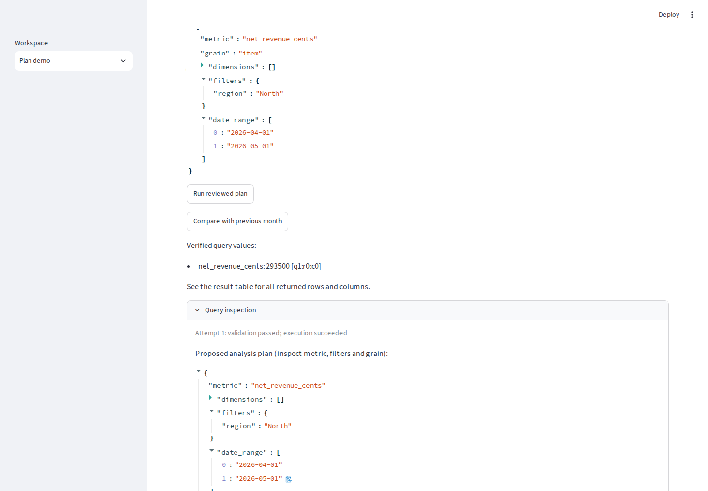
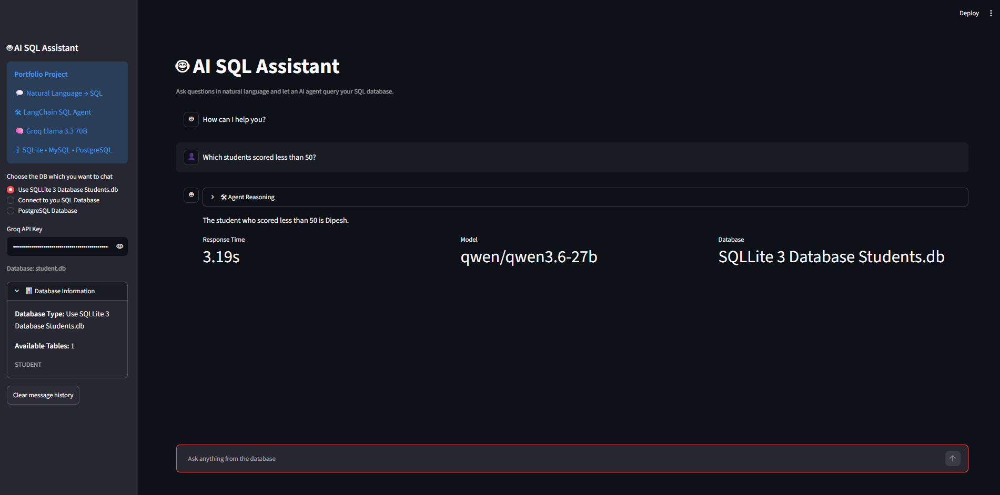
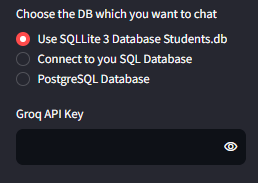
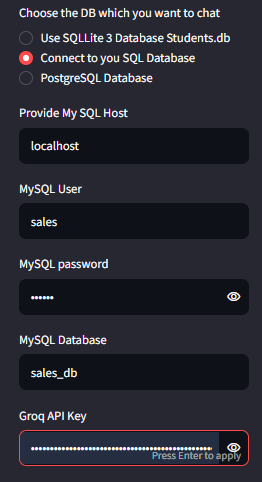
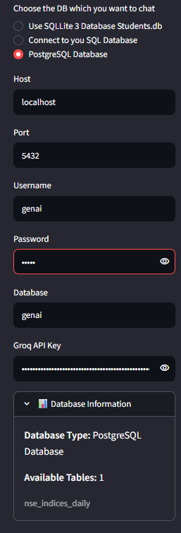
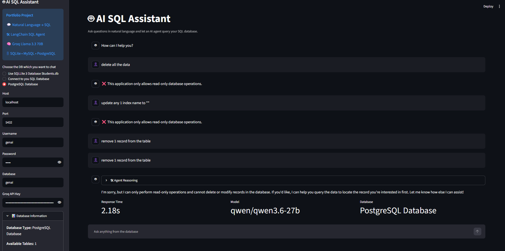

# 🤖 AI SQL Assistant

> A production-inspired Generative AI SQL Assistant that converts natural language into validated, read-only SQL queries using Large Language Models.

## Reviewer demo

[Watch the current walkthrough](assets/current/reviewer-demo.webm) ·
[Live regression evidence](docs/benchmark-reliability-status.md) ·
[Prospective evaluation](docs/prospective-evaluation.md) ·
[Engineering guide](docs/engineering.md)



Start without a provider key:

```bash
docker compose up --build
# Open http://127.0.0.1:8501 and select Plan demo, Evaluation or Benchmarks.
```

The recorded walkthrough demonstrates controlled execution without a model call.
The archived live-model reports separately demonstrate NL-to-SQL behavior.

## Evidence and limits

| Evidence | What it establishes |
| --- | --- |
| Current patch: 372 passing local tests; two database integration tests require endpoints | Filter routing, completion accounting, frozen reference outputs and application regressions. |
| 351 passing tests with disposable PostgreSQL/MySQL in the prior infrastructure snapshot | Application behavior, restricted-reader permissions, truncation and query timeouts. |
| Docker health and in-container canonical-plan smoke | Reproducible reviewer startup and actual controlled execution. |
| Three synthetic data instances | Checks the same SQL against changed counts, refunds, missing values and zero denominators. |
| Recorded live-model/baseline runs, including failures | Measured examples and regression recovery; not general accuracy or production usage. |
| Separate prospective holdout | Questions frozen before provider evaluation; same-author limitation is explicit in the [protocol](docs/prospective-evaluation.md). |

Current change validation is recorded in [the review follow-up](docs/final-review-follow-up.md).
The earlier [infrastructure record](evaluation/infrastructure-validation-2026-10-21.json)
remains unchanged. Hosted identity, verified TLS and real-data access need their
own deployment verification. This is a personal portfolio prototype.

## Overview
This portfolio project demonstrates practical GenAI engineering by combining LLMs, SQL agents, and database connectivity into an interactive Streamlit application.

### Highlights
- Natural Language → SQL
- Bounded LangChain tool-calling workflow
- Groq-hosted LLM (`qwen/qwen3.8-27b` default; configurable)
- SQLite, MySQL and PostgreSQL support
- Read-only SQL enforcement
- SQL AST validation and database read-only safeguards
- Statement, table and function allowlists at execution
- Buffered LLM responses (displayed after processing)
- Database schema discovery
- Interactive chat interface
- Query inspection, result tables and CSV export
- Deterministic retail demo with seven related tables
- Business definitions, clarification and bounded SQL repair
- Grounded charts and filter-preserving month comparisons
- Redacted operational traces and actual token usage when available
- 50-case evaluation dashboard with separate reference and opt-in live modes
- Response time metrics
- Separate connection, validation, execution, generation, chat and presentation modules

## Tech Stack
- Python
- Streamlit
- LangChain
- Groq
- SQLAlchemy
- pandas (result tables, CSV and charts)
- SQLite
- MySQL
- PostgreSQL (psycopg)
- SQLGlot AST validation

## Features
| Feature | Status |
|---|---|
| Natural language querying | ✅ |
| Multi-database support | ✅ |
| Tool-calling SQL Agent | ✅ |
| Read-only protection | ✅ |
| Schema discovery | ✅ |
| Chat history (session) | ✅ |
| Buffered responses | ✅ |
| Performance metrics | ✅ |
| Database information panel | ✅ |
| SQL/assumptions/validation inspection | ✅ |
| Results, row count, truncation and CSV | ✅ |
| Synthetic retail analytics demo | ✅ |
| Business metric definitions and clarification | ✅ |
| Bounded SQL recovery | ✅ |
| Grounded charts and month comparisons | ✅ |
| Redacted operational traces | ✅ |
| 50-case evaluation dashboard/CLI | ✅ |

### Chat Interface


### Database Selection





## Security
- Validates generated SQL before every query execution; natural-language keywords are not a security boundary.
- Prompt instructs the model to generate only SELECT queries.
- SQLite opened in read-only mode.
- Rejects DDL, DML, stacked statements, unapproved tables/functions, comments, locking clauses and SELECT INTO.
- Uses read-only transactions for PostgreSQL/MySQL and execution timeouts. Remote database users must also have SELECT-only privileges.


### SQL Guardrails


## Architecture
```text
Question + bounded conversation
              |
      Clarification / preflight
              |
       Tool-calling model
         /           \
execute_analysis_plan  query_database
         |                 |
Intent checks + compiler   Proposed flexible SQL
         \                 /
          SQL AST validation
                  |
      Read-only execution + limits
                  |
    Results, query inspection, charts
                  |
 Single canonical: deterministic cited facts
 Flexible: fact verification / cited fallback
```

Canonical plans support a constrained retail metric/filter subset. Multi-value,
negated or other recognized unsupported filters route to flexible SQL or
clarification before a canonical plan executes. This recognizer is not a general
natural-language semantics verifier.


## Project Structure
```text
app.py                      Minimal Streamlit launcher
assistant/config.py         Application settings and shared defaults
assistant/ui.py             Sidebar, session reset and UI composition
assistant/runtime.py        Service/model construction and resource cleanup
assistant/connections.py    URLs, connection timeouts, SQLite read-only mode
assistant/validation.py     Generated SQL AST policy
assistant/execution.py      Approved schema and controlled execution
assistant/generation.py     Workflow stages and bounded SQL recovery
assistant/plans.py          Canonical retail metric compilation
assistant/plan_intent.py    Explicit intent checks and unsupported-filter routing
assistant/answers.py        Result-referenced facts and deterministic fallback
assistant/benchmark.py      Paired model/baseline evaluation and completion accounting
assistant/scheduling.py     Shared quota admission within request budgets
assistant/business.py       Versioned retail metric/join/date contract
assistant/demo.py           Reproducible synthetic retail fixture
assistant/followups.py      Deterministic month comparisons
assistant/charts.py         Charts from executed values
assistant/tracing.py        Redacted operational trace allowlist
assistant/evaluation.py     Reference and live result-based evaluation
assistant/evaluation_ui.py  Evaluation dashboard
assistant/chat.py           Bounded history and database-switch reset
assistant/presentation.py   Single render/store per chat turn
evaluation/retail_v1.json   50 regression questions and frozen expected rows
evaluation/prospective_v1.json  Opt-in, frozen same-author prospective suite
tests/                      Offline regression and application tests
sql_queries.sql             PostgreSQL administrator/loader bootstrap
.github/workflows/tests.yml Offline, reference evaluation and live database CI
```

The UI depends on configuration, chat state, presentation and runtime composition.
Runtime constructs the model and database service; it always disposes the engine,
including when initialization or request handling fails. SQL validation and
execution remain independent of Streamlit, so other interfaces can reuse them.
Importing the launcher does not render the UI or connect to a database.

## Installation
```bash
git clone https://github.com/sunshine-engineer/ai-sql-assistant.git
cd ai-sql-assistant
python -m venv .venv
# Activate .venv for your operating system
pip install -r requirements.txt
streamlit run app.py
```

## Why this project?
This application showcases practical GenAI engineering skills including LLM integration, agentic workflows, prompt engineering, SQL safety, multi-database connectivity, bounded context, UI development, and production-oriented guardrails.

## Analytics walkthrough

The default database is a reproducible synthetic retail demo covering
January–April 2026, with a fixed reporting date of May 1, 2026. It is created
locally on first use at `data/retail-v1.db`; existing files are never overwritten.
The legacy five-student database remains selectable in the sidebar. Retail
business definitions apply only to the retail demo, not arbitrary remote schemas.

1. Select **Retail analytics**, supply your Groq key and a supported tool-calling model.
2. Ask: **What is April 2026 net revenue in cents for the North region?**
3. Inspect proposed/validated SQL, tables, assumptions, outcomes, returned rows
   and truncation. Export result CSV or the redacted trace JSON.
4. Ask: **Compare that with last month.** For a query using canonical one-month
   `order_date` bounds, the app executes the same SQL twice with only month bounds
   changed. This preserves its metric and filters without another model call.
5. Select **Evaluation** to run all 50 offline reference checks without an API key,
   or opt into a live model run in small batches. Reference checks are not a model
   accuracy benchmark. The dashboard labels the mode and batch explicitly.

The workflow is **understand → clarify (when needed) → generate → validate →
execute → summarize**. Read-only policy rejections stop immediately; recoverable
SQL errors permit at most two repairs within the four-tool-call/five-round budget.
Charts use returned numeric columns directly and skip ambiguous/duplicate chart
axes rather than inventing aggregations. Monetary columns remain in cents.
Final answers contain facts checked against executed result cells, with references
such as `[q1:r0:c0]`. Invalid model answers receive a cited fallback and fail the
model-answer evaluation score. Assumptions still require inspection: matching
cells does not prove business semantics or answer completeness. Comparisons with
extra instructions ask clarification before execution.

See [the analytics design and evaluation guide](docs/analytics.md) for contracts,
limitations, operational traces and commands.

## Engineering evidence

Start with **Plan demo** for a key-free walkthrough using real controlled SQL.
See [the engineering guide](docs/engineering.md) for canonical analysis plans,
three-instance SQL evaluation, repeated paired live benchmarks, budgets, metadata
selection, sanitized operational aggregates, and hosted access configuration.
[Measured benchmark results](docs/benchmark-report.md) include failures and quota
limitations. [Reliability fixes and completed live confirmations](docs/benchmark-reliability-status.md)
record the current follow-up. [Current screenshots and walkthrough](assets/current/README.md) show
real controlled execution without a provider key. [Validation scope](docs/engineering-validation.md)
distinguishes local tests, live measurements and the scope of infrastructure verification. Run `docker compose up --build` for the synthetic-only reviewer package.

## Future Improvements
- Validate OIDC, per-user DB grants and certificate verification in hosted infrastructure
- Larger held-out and cross-dialect model evaluation
- Domain contracts for user-supplied schemas

## License
MIT

## Safety policy and limits

For the retail demo, the model can use `execute_analysis_plan` or `query_database`;
other schemas use the flexible SQL tool. Every execution passes through the same
validator. The initial policy permits simple SELECTs, joins and subqueries;
CTEs, set operations, comments and functions outside the small allowlist are
intentionally rejected. This is a conservative subset, not full SQL support.
Metadata contains column names/types, not sample rows. Local mode discovers tables in the selected
schema; hosted mode uses operator-approved views and column projections.
Python callers can further restrict tables using `QueryService(tables=[...])`.
Use database grants to restrict sensitive tables/columns for deployed use.

Defaults: 200 result rows, 20,000-character serialized tool results (large rows
may be omitted), 5-second query timeout, four query calls, five model rounds and at most two recoverable SQL repairs.
Only the most recent eight messages, each capped at 2,000 characters, are sent
as conversational context. Switching database connection settings/schema or
clearing history resets the chat. Credentials are not included in model context
or displayed errors. Connections are not globally cached across users.
Responses are buffered, not token-streamed. Earlier screenshots may show the old UI.

### PostgreSQL credentials

`sql_queries.sql` is a **psql bootstrap for a new database**. Run from the
repository root with administrator credentials; `\password` prompts for new
role passwords. It creates separate `genai_loader` and `genai_reader` roles,
loads data with client-side `\copy`, and grants the reader only schema usage,
connection and table SELECT privileges. Use **genai_reader** in the application.
Do not rerun bootstrap against an existing installation. Existing broad roles
are not repaired automatically: provision a fresh restricted reader, audit any
PUBLIC/inherited privileges, then switch the app to that account. Retire the old
assistant credentials separately. Never grant server-file roles to the reader.

### MySQL credentials

For MySQL 8, provision a dedicated role/user with SELECT on approved tables only;
never use root, the loader or an account with FILE/EXECUTE/write privileges.
The application also requests read-only transactions and sets
`MAX_EXECUTION_TIME`. It fixes session SQL mode to strict transactions, full
GROUP BY checks and standard backslash escapes so server parsing matches the
validator; PostgreSQL similarly enables standard-conforming strings. This path targets MySQL, not MariaDB. Administrative SQL
runs outside the model execution path. Review permissions on views, functions,
and PUBLIC/inherited roles before deployment: an AST validator is defense in
depth, not a replacement for database access control.

## Testing

```bash
python -m pip install -r requirements-dev.txt
python -m pip check
python -m pytest -q
```

The default tests are offline: real temporary SQLite databases, SQL policy
regressions, fake-model tool calls, bounded history, connection construction,
and Streamlit application smoke/regression checks. They require no API key.
GitHub Actions runs the offline suite on Python 3.12 and a separate integration
job against disposable PostgreSQL 16 and MySQL 8 services. The two live-server
tests skip locally unless `TEST_POSTGRES_ADMIN_URL` and
`TEST_MYSQL_ADMIN_URL` point to disposable databases. They create and remove
fixture tables and reader roles; never point them at a real application database. Live Groq and remote database
verification require separately supplied services/credentials; offline tests
must not be described as proof of model accuracy or live remote enforcement.


### Evaluation commands

```bash
# Offline reference-fixture validation: no provider calls or model accuracy claim.
python -m assistant.evaluation --output evaluation/results/reference.json

# Live mode: set GROQ_API_KEY in your local environment first; never commit it.
# Uses the selected provider/model and your quota. Start with a small batch.
python -m assistant.evaluation --live --limit 5 --offset 0 --output evaluation/results/live-batch.json
```

The 50 curated cases include 30 result questions (joins, aggregations and dates),
8 ambiguity cases, 6 adversarial inputs and 6 unsupported requests. Expected rows
are frozen in `evaluation/retail_v1.json` against the versioned synthetic fixture.
Result comparison checks values, multiplicity, requested ordering and truncation;
column aliases may differ, numeric comparisons have a small tolerance.
Live results separately report result correctness, clarification, refusal and
unsupported-request outcomes. Unavailable token usage remains null; partial usage
is marked incomplete. CLI failures exit nonzero. GitHub Actions uploads the
offline reference report; live model evaluation is opt-in and requires credentials.
