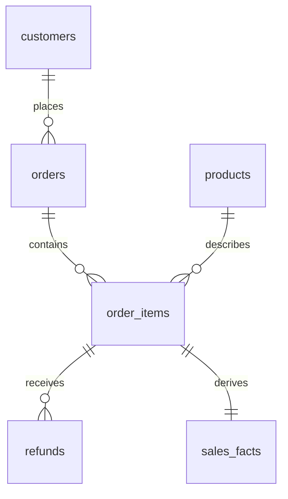

# Analytics workflow and evaluation

Outline: data and definitions, query inspection, recovery and follow-ups,
evaluation, trace privacy, and verification boundaries.

For operator setup, configuration, recovery and ownership, start with the
[current handover guide](HANDOVER.md).

## Data and business contract

All data is synthetic. `python -m assistant.demo --output data/retail-v1.db`
creates a deterministic SQLite fixture without overwriting existing files.
It contains 12 customers, 7 products, 144 orders, 288 items, split refund events,
12 monthly category targets and 288 item-grain sales facts. Orders cover
January–April 2026; the reporting anchor is May 1, 2026. No wall-clock-relative
fixture dates or randomness change answers between runs.

`assistant/business.py` holds the versioned metric definitions, approved join
guidance, date conventions, missing-data rules and synonyms. Amounts are integer
USD cents. Gross sales exclude cancelled orders. Net revenue subtracts all
refunds attributed to the original order month. Refunds can contain multiple
rows per item. Generated SQL must use sales_facts for refund analysis; raw
refund joins are blocked rather than accepted merely because an aggregation
appears in the SQL.
`sales_facts` pre-aggregates refunds to item grain to avoid this fan-out.
Monthly/category targets must join a monthly/category aggregate on both keys.

Unknown regions are NULL, not silently attributed to another region. One customer
has no orders and one product has never sold. There is no cost/profit, forecast,
PII or external market data. Requests for unqualified revenue, growth or "best
performing" trigger clarification in the demo. This small deterministic policy
is a baseline; it is not a comprehensive natural-language intent classifier.
The model receives the full contract for additional clarification and generation.
Approved-join guidance is not a general-purpose SQL semantic proof: correct
business meaning still requires inspection and result evaluation.

## Inspectable execution and recovery

Each response can retain up to eight recent answers' query evidence in session:
proposed SQL, normalized SQL with enforced limits, referenced tables, assumptions,
validation/execution outcomes, result columns/rows, returned row count,
truncation and timing. Evidence is cleared with the conversation on a connection
change. Assumptions are model supplied and may be wrong.

The retail workflow offers execute_analysis_plan and query_database. Supported
plans compile canonical metric expressions and pass explicit intent checks.
Recognized multi-value, OR, negated or unsupported conditions route to controlled
flexible SQL or clarification before a partial canonical plan can execute.
The recognizer is not general intent verification.

Only the controlled query service executes model SQL. It validates at preview
and execution boundaries. Read-only policy rejections are terminal. Recoverable
identifier/syntax errors allow at most two repairs; timeouts and connection
errors stop. Maximums remain four tool calls and five model rounds. A single successful canonical-plan call renders cited facts deterministically,
without a second model summary. Flexible SQL and multi-tool turns use the
structured-answer verification path below. A final
numerical answer needs successful query evidence; otherwise the workflow asks
for clarification. For the model-summary path, the candidate must contain structured facts with `result_id`,
zero-based `row` and `column`, and `value`. References must point to the last
successful result and match its cells. The app renders cited source values.
Invalid answers receive a deterministic fallback; raw model prose is not shown.
Cell verification does not prove business semantics or answer completeness.

Charts select an unambiguous dimension and numeric measure from actual returned
rows. Duplicate axis labels or ambiguous shapes skip charting. No LLM-generated
Python, JavaScript or chart expressions execute. No inferred aggregation or
fabricated values fill gaps. CSV exports contain the displayed result values.

## Month comparisons and follow-ups

Normal chat receives bounded prior conversation and previous validated analysis.
For **"compare that with last month"**, a deterministic path clones the previous
SQL and changes only its `order_date` bounds. It executes both queries through the
same controlled tool, labels the periods and combines at most 200 displayed rows.
This preserves the actual aggregation, metric, category and region filters;
no model call reinterprets them. Previous model assumptions are not a proof of
SQL correctness; the SQL expression itself is preserved.

The deterministic path requires one half-open ISO calendar month in a top-level
AND-only WHERE clause with no subqueries, negation or OR. Both positive bounds
must directly reference the same date column, with no extra date conditions.
Unsupported shapes ask clarification. Extra instructions such as “use South
instead of North” also ask clarification before execution; restate the changed
analysis first.
A comparison outside the retail fixture's date coverage is explicitly unsupported.
Top-N membership can differ between months. Other follow-ups use bounded model
context and do not have the same deterministic preservation guarantee.

## Evaluation methodology

`evaluation/retail_v1.json` contains exactly 50 curated cases and the frozen
expected values for 30 result questions. Reference SQL is curated in the repository;
expected rows were materialized once from the deterministic fixture. Cases cover
joins/fan-out, cancellation rules, missing values, empty relationships,
aggregation, monthly ranges, target attainment, ambiguity and adversarial inputs.
They are development cases, not a held-out generalization benchmark.

Two modes have distinct meanings:

- **Reference fixture**: execute trusted reference SQL through the controlled
  service and compare to frozen rows; run deterministic clarification/refusal/
  unsupported controls. This checks fixtures and application regressions, not LLM
  quality. It makes no provider call and needs no API key.
- **Live model**: ask the workflow each question, execute its generated SQL, and
  compare the final executed result to the frozen rows. Report query result
  correctness and model-answer faithfulness separately, alongside clarification,
  refusal and unsupported outcomes. Answered cases in the workflow evaluation must pass SQL-result and answer
  checks. Deterministic answers use displayed verification, while model-generated
  candidates use model verification. A safe fallback does not rescue a rejected
  model candidate's score.
  Preflight controls can resolve some cases without a model call, so outcome
  scores measure the application, not exclusively the LLM.

Results compare width, row multiplicity, values and requested ordering; aliases
may vary. Numeric tolerance is `rel_tol=1e-7, abs_tol=1e-6`. Truncated/error results
fail rather than being compared as complete. A correct-looking prose answer
cannot hide a wrong executed result. A false numerical answer fails even with
correct SQL results. Offline answer scores are marked not evaluated.
Unrestricted prose accuracy, latency under concurrent
load, remote SQL dialect quality and prompt-injection generalization are not
measured. Keep separate held-out cases for any future performance claims.

The dashboard runs a selected batch (default live batch: five cases), labels its
mode and scope, displays category/outcome scores and latency p50/p95, and exports
JSON. Exports include case IDs and redacted traces, not arbitrary prompts, SQL or
result rows. Reports are stored in session or in the ignored
`evaluation/results/` directory for new runs. Frozen live reports are bundled in
`evaluation/reports/` and shown in Benchmarks; their source/suite versions and
limitations must be preserved. The opt-in [prospective set](prospective-evaluation.md)
is same-author, not independently authored. Its six SQL tasks and two application
controls have separate meanings.
Model/provider failures and rate limits are recorded as failed cases. The assistant.evaluation CLI
returns nonzero for any case failure. The paired assistant.benchmark CLI returns
zero after writing a report even when cases fail or a provider-stop ends the run;
inspect rows, completion and per-approach summaries. Consistency requires every
planned repetition to be recorded once and pass; incomplete and unattempted
cases are separate. One repeat establishes no repeated-run stability. Reference checks also run in CI and are
uploaded as an artifact. No automatic live provider calls run in CI.

## Operational trace privacy

Operational exports use a strict field allowlist: generated request ID,
UTC timestamp, prompt version, sanitized model identifier, workflow stages and
elapsed times, model-call durations/outcomes, query fingerprint, validation and
execution outcomes, error category, returned row count, truncation, repair count,
and token usage when the provider supplies it. Literals are removed before query
fingerprinting. No prompt, message, schema text, raw SQL, SQL parameter, result,
assumption, answer text, database URL, API key or raw exception is exported.
Partial token totals are marked incomplete; unavailable usage is null. There is
no fabricated cost metric. Optional local operational aggregation is enabled
with ASSISTANT_TELEMETRY_PATH; it stores sanitized counters, not full traces, and
has no managed monitoring service or automatic retention. See the handover guide
for its privacy boundary and connection-error aggregation limitation. Session query
inspection intentionally contains actual SQL/results; it is distinct from the
redacted operational export. CSV download is an explicit result export.

## Validation boundaries

Offline tests use real temporary SQLite fixtures and a scripted model. They
cover frozen expected values, mismatched results, bounded repairs, refusal before
execution, trace redaction, filter-preserving comparisons, chart provenance,
resource cleanup and Streamlit interaction. Fake-model tests exercise plumbing,
not provider availability or model reasoning quality. Live PostgreSQL/MySQL CI
retains the existing permission/timeout integration tests. Groq model evaluation
requires an actual supported model and a user-supplied key; run small batches on
a free tier. No commercial production usage or model accuracy is claimed.
